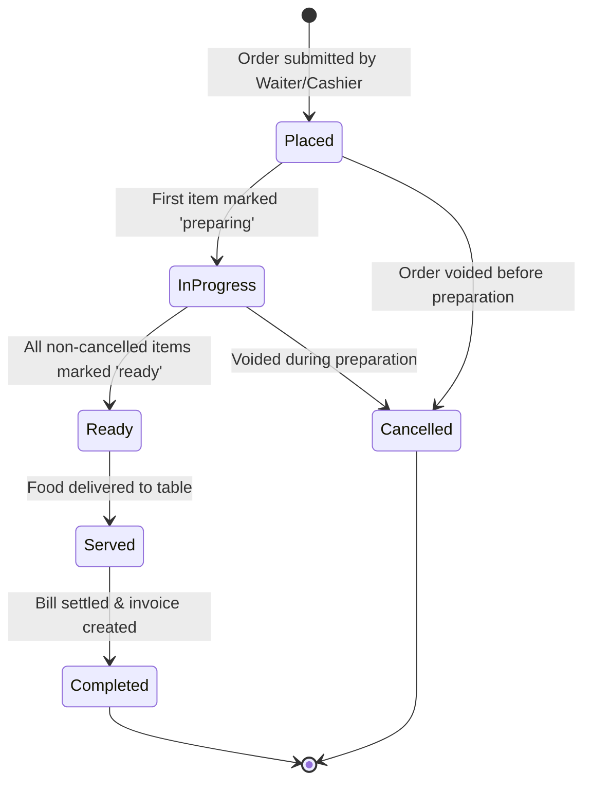
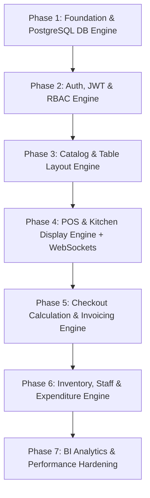

# Senior API & Backend Engineering Specification: Coozy The Cafe (Go / Golang Stack)

> **Document Type**: Comprehensive API Specification, Screen-to-Click Mapping, and Production Roadmap  
> **Target Framework**: Go (Golang 1.22+), Chi / Gin / Fiber, PostgreSQL 15+ (pgx / sqlc / GORM), Redis (Pub/Sub & Cache), WebSocket / SSE  
> **Version**: 2.0.0-PROD  
> **Authors**: Senior API Architect & Backend Engineering Lead

---

## 1. Global API Standards & Envelope Architecture

To guarantee deterministic error handling, distributed tracing, client observability, and idempotency across Web, Mobile (Flutter), and Desktop clients, all endpoints strictly enforce standard JSON envelopes and HTTP headers.

### 1.1 Mandatory Request & Response Headers

| Header Name | Type | Direction | Description |
| :--- | :--- | :--- | :--- |
| `X-Transaction-ID` | UUIDv4 | Request / Response | Unique transaction/trace ID generated per request. Echoed back in every response. |
| `X-Idempotency-Key` | UUIDv4 | Request (Mutations) | Required on financial and creation mutations (`POST /orders`, `POST /invoices`, `POST /inventory/adjust`). Prevents duplicate execution. |
| `Authorization` | String | Request | `Bearer <JWT_ACCESS_TOKEN>` |
| `X-Client-Version` | String | Request | Client app version (e.g. `coozy-flutter-web/2.1.0`). |
| `Content-Type` | String | Both | `application/json` |

---

### 1.2 Standard Success Envelope (`2xx`)

```json
{
  "success": true,
  "transaction_id": "8f3b2a19-9c56-4b2e-a0e2-63b27b9c41d1",
  "timestamp": "2026-10-18T22:00:00Z",
  "message": "Resource retrieved successfully.",
  "data": {},
  "meta": {
    "page": 1,
    "limit": 20,
    "total_records": 142,
    "total_pages": 8
  }
}
```

---

### 1.3 Standard Error Envelope (`4xx` / `5xx`)

```json
{
  "success": false,
  "transaction_id": "8f3b2a19-9c56-4b2e-a0e2-63b27b9c41d1",
  "timestamp": "2026-10-18T22:00:00Z",
  "error": {
    "code": "INSUFFICIENT_STOCK",
    "message": "The requested item 'Espresso Blend' does not have enough stock.",
    "field_errors": [
      {
        "field": "items[0].quantity",
        "rejected_value": 15,
        "reason": "Available quantity is only 4.2 kg."
      }
    ],
    "help_url": "https://docs.coozythecafe.com/errors/INSUFFICIENT_STOCK"
  }
}
```

#### Canonical Error Code Matrix:
- `VALIDATION_FAILED` (`422 Unprocessable Entity`): Missing/malformed payload attributes.
- `UNAUTHENTICATED` (`401 Unauthorized`): Invalid/expired JWT token or missing credentials.
- `FORBIDDEN` (`403 Forbidden`): Authenticated user lacks permission (`RolePermission`).
- `RESOURCE_NOT_FOUND` (`404 Not Found`): Requested entity UUID does not exist.
- `CONFLICT_STATE` (`409 Conflict`): Unique constraint violation or table already occupied.
- `IDEMPOTENCY_CONFLICT` (`409 Conflict`): Operation already executed for this `X-Idempotency-Key`.
- `INSUFFICIENT_STOCK` (`422 Unprocessable Entity`): Cannot deduct requested inventory balance.
- `INTERNAL_SERVER_ERROR` (`500 Internal Server Error`): Unhandled exception; trace stored in logs.

---

## 2. Universal Enums, Finite State Machines (FSM) & Domain Constants

This section defines every domain enumeration used throughout the system. For PostgreSQL, these should be defined as native `CREATE TYPE ... AS ENUM (...)` or strongly validated `VARCHAR` checks. In Go, these correspond to typed string constants implementing `sql.Scanner`, `driver.Valuer`, and `json.Marshaler`.

### 2.1 Complete Enum Catalog & Mapping

```go
package domain

// ----------------------------------------------------------------------------
// 1. User Roles & Access Control (RBAC)
// ----------------------------------------------------------------------------
type UserRole string

const (
    UserRoleSuperUser UserRole = "superuser"
    UserRoleAdmin     UserRole = "admin"
    UserRoleOwner     UserRole = "owner"
    UserRoleManager   UserRole = "manager"
    UserRoleWaiter    UserRole = "waiter"
    UserRoleCashier   UserRole = "cashier"
    UserRoleChef      UserRole = "chef"
    UserRoleStaff     UserRole = "staff"
)

// ----------------------------------------------------------------------------
// 2. Order Status & Order Item Status (POS & KDS FSM)
// ----------------------------------------------------------------------------
type OrderStatus string

const (
    OrderStatusPlaced     OrderStatus = "placed"     // Order created & sent to kitchen
    OrderStatusInProgress OrderStatus = "inProgress" // At least one item is being prepared
    OrderStatusReady      OrderStatus = "ready"      // All items prepared and ready to serve
    OrderStatusServed     OrderStatus = "served"     // Food delivered to table/customer
    OrderStatusCompleted  OrderStatus = "completed"  // Bill paid & settled
    OrderStatusCancelled  OrderStatus = "cancelled"  // Voided / Cancelled order
)

type OrderItemStatus string

const (
    OrderItemStatusPending   OrderItemStatus = "pending"   // Waiting for chef to start
    OrderItemStatusPreparing OrderItemStatus = "preparing" // Cooking in kitchen
    OrderItemStatusReady     OrderItemStatus = "ready"     // Cooked & waiting on pass
    OrderItemStatusServed    OrderItemStatus = "served"    // Delivered to customer
    OrderItemStatusCancelled OrderItemStatus = "cancelled" // Cancelled by customer/waiter
)

// ----------------------------------------------------------------------------
// 3. Table Occupancy Status (Floor Layout)
// ----------------------------------------------------------------------------
type TableStatus string

const (
    TableStatusEmpty       TableStatus = "empty"       // Vacant and clean
    TableStatusOccupied    TableStatus = "occupied"    // Customers seated / active order
    TableStatusPendingBill TableStatus = "pendingBill" // Food served, awaiting bill payment
    TableStatusReserved    TableStatus = "reserved"    // Reserved for upcoming party
)

// ----------------------------------------------------------------------------
// 4. Order Types & Dining Modes
// ----------------------------------------------------------------------------
type OrderType string

const (
    OrderTypeDineIn   OrderType = "dine_in"
    OrderTypeTakeaway OrderType = "takeaway"
    OrderTypeDelivery OrderType = "delivery"
)

// ----------------------------------------------------------------------------
// 5. Food Dietary Classifications
// ----------------------------------------------------------------------------
type FoodType string

const (
    FoodTypeVeg     FoodType = "veg"
    FoodTypeNonVeg  FoodType = "non-veg"
    FoodTypeVegan   FoodType = "vegan"
    FoodTypeEgg     FoodType = "egg"
)

// ----------------------------------------------------------------------------
// 6. Reservation Status Codes
// ----------------------------------------------------------------------------
type ReservationStatus int

const (
    ReservationStatusPending   ReservationStatus = 0 // Booking requested
    ReservationStatusConfirmed ReservationStatus = 1 // Table locked & confirmed
    ReservationStatusSeated    ReservationStatus = 2 // Guests arrived and seated
    ReservationStatusCompleted ReservationStatus = 3 // Finished dining
    ReservationStatusCancelled ReservationStatus = 4 // Booking cancelled
)

// ----------------------------------------------------------------------------
// 7. Inventory Stock Adjustment Types
// ----------------------------------------------------------------------------
type StockAdjustmentType string

const (
    StockAdjustmentTypeAdd    StockAdjustmentType = "add"    // Stock in (found, opening, returns)
    StockAdjustmentTypeRemove StockAdjustmentType = "remove" // Stock out (wastage, spoilage, theft)
)

// ----------------------------------------------------------------------------
// 8. Staff Attendance & Leave Status
// ----------------------------------------------------------------------------
type AttendanceStatus int

const (
    AttendanceStatusAbsent  AttendanceStatus = 0
    AttendanceStatusPresent AttendanceStatus = 1
    AttendanceStatusHalfDay AttendanceStatus = 2
)

type LeaveStatus int

const (
    LeaveStatusPending  LeaveStatus = 0
    LeaveStatusApproved LeaveStatus = 1
    LeaveStatusRejected LeaveStatus = 2
)

// ----------------------------------------------------------------------------
// 9. Expenditure Categories & Types
// ----------------------------------------------------------------------------
type ExpenditureType string

const (
    ExpenditureTypeExpense ExpenditureType = "EXPENSE" // OPEX, Supplies, Salaries, Utilities
    ExpenditureTypeIncome  ExpenditureType = "INCOME"  // Miscellaneous income, scrap sale
)

type ExpenditureReferenceType string

const (
    ExpenditureRefManual   ExpenditureReferenceType = "MANUAL"
    ExpenditureRefPurchase ExpenditureReferenceType = "PURCHASE"
    ExpenditureRefSalary   ExpenditureReferenceType = "SALARY"
    ExpenditureRefOrder    ExpenditureReferenceType = "ORDER"
)

// ----------------------------------------------------------------------------
// 10. Discount & Fee Types
// ----------------------------------------------------------------------------
type DiscountCalculationType int

const (
    DiscountTypePercentage DiscountCalculationType = 0 // e.g. 10%
    DiscountTypeFlatAmount DiscountCalculationType = 1 // e.g. ₹50 off
)

// ----------------------------------------------------------------------------
// 11. Reports & Period Formats
// ----------------------------------------------------------------------------
type SalesPeriodFormat string

const (
    SalesPeriodDaily   SalesPeriodFormat = "daily"
    SalesPeriodWeekly  SalesPeriodFormat = "weekly"
    SalesPeriodMonthly SalesPeriodFormat = "monthly"
    SalesPeriodYearly  SalesPeriodFormat = "yearly"
)

type ReportType string

const (
    ReportTypeSalesTrends      ReportType = "salesTrends"
    ReportTypeDailySales       ReportType = "dailySales"
    ReportTypeMonthlySales     ReportType = "monthlySales"
    ReportTypeTopSellingItems  ReportType = "topSellingItems"
    ReportTypePaymentModes     ReportType = "paymentModes"
    ReportTypeSalesDashboard   ReportType = "salesDashboard"
    ReportTypeInventoryStock   ReportType = "inventoryStock"
    ReportTypePurchases        ReportType = "purchases"
    ReportTypeExpenditure      ReportType = "expenditure"
    ReportTypeMenuItemSales    ReportType = "menuItemSales"
    ReportTypeStockAdjustments ReportType = "stockAdjustments"
)

// ----------------------------------------------------------------------------
// 12. App Settings, Theme Modes & Thermal Printing
// ----------------------------------------------------------------------------
type ThemeMode string

const (
    ThemeModeSystem ThemeMode = "system"
    ThemeModeLight  ThemeMode = "light"
    ThemeModeDark   ThemeMode = "dark"
)

type ThermalPrinterType string

const (
    ThermalPrinterNetwork       ThermalPrinterType = "network"
    ThermalPrinterBluetooth     ThermalPrinterType = "bluetooth"
    ThermalPrinterUSB           ThermalPrinterType = "usb"
    ThermalPrinterSystemSpooler ThermalPrinterType = "systemSpooler"
)

type ThermalPaperSize string

const (
    ThermalPaperSize58mm ThermalPaperSize = "mm58"
    ThermalPaperSize80mm ThermalPaperSize = "mm80"
)
```

---

### 2.2 Kitchen Display System (KDS) Finite State Machine (FSM)

The Go backend must enforce strict valid transitions between states:



#### Order Item State Progression Rules:
1. When item is `pending`, valid transition is $\rightarrow$ `preparing` or `cancelled`.
2. When item is `preparing`, valid transition is $\rightarrow$ `ready` or `cancelled`.
3. When item is `ready`, valid transition is $\rightarrow$ `served` or `cancelled`.
4. If **all active items** in an order become `ready`, backend automatically sets parent `order.status = "ready"`.
5. If **any active item** in an order becomes `preparing`, backend sets parent `order.status = "inProgress"`.

---

## 3. Complete Database Table Schemas (PostgreSQL 15+ DDL)

Every primary table uses UUID (`UUIDv4`) for external referencing (`hash_id`), standard audit trails (`created_by`, `updated_by`, `created_at`, `updated_at`), soft-delete flags where applicable, and indexed foreign key constraints.

```sql
-- Enable UUID extension
CREATE EXTENSION IF NOT EXISTS "uuid-ossp";

-- ============================================================================
-- 1. ROLES & PERMISSIONS (RBAC)
-- ============================================================================
CREATE TABLE roles (
    id SERIAL PRIMARY KEY,
    name VARCHAR(50) UNIQUE NOT NULL,
    description TEXT,
    created_at TIMESTAMPTZ DEFAULT NOW(),
    updated_at TIMESTAMPTZ DEFAULT NOW()
);

CREATE TABLE permissions (
    id SERIAL PRIMARY KEY,
    name VARCHAR(100) UNIQUE NOT NULL,
    description TEXT,
    created_at TIMESTAMPTZ DEFAULT NOW()
);

CREATE TABLE role_permissions (
    id SERIAL PRIMARY KEY,
    role_id INT NOT NULL REFERENCES roles(id) ON DELETE CASCADE,
    permission_id INT NOT NULL REFERENCES permissions(id) ON DELETE CASCADE,
    created_at TIMESTAMPTZ DEFAULT NOW(),
    UNIQUE(role_id, permission_id)
);

CREATE TABLE user_logins (
    id SERIAL PRIMARY KEY,
    hash_id UUID DEFAULT uuid_generate_v4() UNIQUE NOT NULL,
    first_name VARCHAR(100) NOT NULL,
    last_name VARCHAR(100) NOT NULL,
    username VARCHAR(100) UNIQUE NOT NULL,
    email VARCHAR(255) UNIQUE NOT NULL,
    phone_number VARCHAR(30),
    iso_code VARCHAR(10) DEFAULT '+91',
    gender VARCHAR(20),
    password_hash TEXT NOT NULL,
    birth_date DATE,
    role_id INT REFERENCES roles(id) ON DELETE SET NULL,
    is_active BOOLEAN DEFAULT TRUE,
    created_at TIMESTAMPTZ DEFAULT NOW(),
    updated_at TIMESTAMPTZ DEFAULT NOW()
);
CREATE INDEX idx_user_logins_role ON user_logins(role_id);
CREATE INDEX idx_user_logins_email ON user_logins(email);

-- ============================================================================
-- 2. TABLE & FLOOR LAYOUT MANAGEMENT
-- ============================================================================
CREATE TABLE table_info (
    id SERIAL PRIMARY KEY,
    hash_id UUID DEFAULT uuid_generate_v4() UNIQUE NOT NULL,
    table_label VARCHAR(100),
    table_no VARCHAR(50) NOT NULL,
    color_value VARCHAR(20),
    sort_order_index INT DEFAULT 0,
    nos_of_chairs INT DEFAULT 2,
    is_active BOOLEAN DEFAULT TRUE,
    created_by INT REFERENCES user_logins(id) ON DELETE SET NULL,
    updated_by INT REFERENCES user_logins(id) ON DELETE SET NULL,
    created_at TIMESTAMPTZ DEFAULT NOW(),
    updated_at TIMESTAMPTZ DEFAULT NOW()
);
CREATE INDEX idx_table_info_sort ON table_info(sort_order_index);
CREATE INDEX idx_table_info_active ON table_info(is_active);

-- ============================================================================
-- 3. MENU CATEGORIES & SUBCATEGORIES
-- ============================================================================
CREATE TABLE menu_categories (
    id SERIAL PRIMARY KEY,
    hash_id UUID DEFAULT uuid_generate_v4() UNIQUE NOT NULL,
    name VARCHAR(150) NOT NULL,
    is_active BOOLEAN DEFAULT TRUE,
    position INT DEFAULT 0,
    created_by INT REFERENCES user_logins(id) ON DELETE SET NULL,
    updated_by INT REFERENCES user_logins(id) ON DELETE SET NULL,
    created_at TIMESTAMPTZ DEFAULT NOW(),
    updated_at TIMESTAMPTZ DEFAULT NOW()
);
CREATE INDEX idx_categories_position ON menu_categories(position);
CREATE INDEX idx_categories_active ON menu_categories(is_active);

CREATE TABLE menu_subcategories (
    id SERIAL PRIMARY KEY,
    hash_id UUID DEFAULT uuid_generate_v4() UNIQUE NOT NULL,
    name VARCHAR(150) NOT NULL,
    category_id INT NOT NULL REFERENCES menu_categories(id) ON DELETE CASCADE,
    is_active BOOLEAN DEFAULT TRUE,
    position INT DEFAULT 0,
    created_by INT REFERENCES user_logins(id) ON DELETE SET NULL,
    updated_by INT REFERENCES user_logins(id) ON DELETE SET NULL,
    created_at TIMESTAMPTZ DEFAULT NOW(),
    updated_at TIMESTAMPTZ DEFAULT NOW()
);
CREATE INDEX idx_subcategories_category_id ON menu_subcategories(category_id);
CREATE INDEX idx_subcategories_position ON menu_subcategories(position);

-- ============================================================================
-- 4. MENU ITEMS & ITEM VARIATIONS (PORTIONS / SIZES)
-- ============================================================================
CREATE TABLE menu_items (
    id SERIAL PRIMARY KEY,
    hash_id UUID DEFAULT uuid_generate_v4() UNIQUE NOT NULL,
    name VARCHAR(255) NOT NULL,
    description TEXT,
    food_type VARCHAR(50) DEFAULT 'veg', -- 'veg', 'non-veg', 'vegan', 'egg'
    duration INT DEFAULT 15,            -- Kitchen preparation duration in mins
    category_id INT REFERENCES menu_categories(id) ON DELETE SET NULL,
    subcategory_id INT REFERENCES menu_subcategories(id) ON DELETE SET NULL,
    is_today_available BOOLEAN DEFAULT TRUE,
    is_simple_variation BOOLEAN DEFAULT TRUE,
    cost_price NUMERIC(12,2) DEFAULT 0.00,
    selling_price NUMERIC(12,2) DEFAULT 0.00,
    stock_quantity NUMERIC(12,2) DEFAULT 0.00,
    quantity VARCHAR(50),
    purchase_unit VARCHAR(50),
    sort_order_index INT DEFAULT 0,
    created_by INT REFERENCES user_logins(id) ON DELETE SET NULL,
    updated_by INT REFERENCES user_logins(id) ON DELETE SET NULL,
    created_at TIMESTAMPTZ DEFAULT NOW(),
    updated_at TIMESTAMPTZ DEFAULT NOW()
);
CREATE INDEX idx_menu_items_cat_sub ON menu_items(category_id, subcategory_id);
CREATE INDEX idx_menu_items_available ON menu_items(is_today_available);
CREATE INDEX idx_menu_items_sort ON menu_items(sort_order_index);

CREATE TABLE menu_item_variations (
    id SERIAL PRIMARY KEY,
    hash_id UUID DEFAULT uuid_generate_v4() UNIQUE NOT NULL,
    menu_item_id INT NOT NULL REFERENCES menu_items(id) ON DELETE CASCADE,
    name VARCHAR(150) NOT NULL, -- e.g. Small, Medium, Large, Half, Full
    quantity INT DEFAULT 1,
    purchase_unit VARCHAR(50),
    is_today_available BOOLEAN DEFAULT TRUE,
    cost_price NUMERIC(12,2) DEFAULT 0.00,
    selling_price NUMERIC(12,2) DEFAULT 0.00,
    stock_quantity INT DEFAULT 0,
    sort_order_index INT DEFAULT 0,
    created_by INT REFERENCES user_logins(id) ON DELETE SET NULL,
    updated_by INT REFERENCES user_logins(id) ON DELETE SET NULL,
    created_at TIMESTAMPTZ DEFAULT NOW(),
    updated_at TIMESTAMPTZ DEFAULT NOW()
);
CREATE INDEX idx_menu_item_variations_item ON menu_item_variations(menu_item_id);

CREATE TABLE menu_item_reviews (
    id SERIAL PRIMARY KEY,
    item_id INT REFERENCES menu_items(id) ON DELETE CASCADE,
    customer_id INT,
    rating NUMERIC(3,2) CHECK (rating >= 1.0 AND rating <= 5.0),
    review_text TEXT,
    review_date TIMESTAMPTZ DEFAULT NOW(),
    created_at TIMESTAMPTZ DEFAULT NOW()
);
CREATE INDEX idx_item_reviews_item ON menu_item_reviews(item_id);

-- ============================================================================
-- 5. CUSTOMERS (CRM) & RESERVATIONS
-- ============================================================================
CREATE TABLE customers (
    id SERIAL PRIMARY KEY,
    hash_id UUID DEFAULT uuid_generate_v4() UNIQUE NOT NULL,
    name VARCHAR(150),
    phone_number VARCHAR(30) NOT NULL,
    iso_code VARCHAR(10) DEFAULT '+91',
    created_by INT REFERENCES user_logins(id) ON DELETE SET NULL,
    created_at TIMESTAMPTZ DEFAULT NOW(),
    updated_at TIMESTAMPTZ DEFAULT NOW()
);
CREATE UNIQUE INDEX idx_customers_phone_iso ON customers(phone_number, iso_code);
CREATE INDEX idx_customers_name ON customers(name);

CREATE TABLE reservations (
    id SERIAL PRIMARY KEY,
    hash_id UUID DEFAULT uuid_generate_v4() UNIQUE NOT NULL,
    customer_id INT REFERENCES customers(id) ON DELETE SET NULL,
    customer_name VARCHAR(150),
    phone_number VARCHAR(30),
    iso_code VARCHAR(10),
    table_id INT REFERENCES table_info(id) ON DELETE SET NULL,
    table_name VARCHAR(100),
    reservation_date_time TIMESTAMPTZ NOT NULL,
    number_of_people INT DEFAULT 2,
    status INT DEFAULT 0, -- 0: Pending, 1: Confirmed, 2: Seated, 3: Completed, 4: Cancelled
    occasion VARCHAR(100),
    notes TEXT,
    created_by INT REFERENCES user_logins(id) ON DELETE SET NULL,
    updated_by INT REFERENCES user_logins(id) ON DELETE SET NULL,
    created_at TIMESTAMPTZ DEFAULT NOW(),
    updated_at TIMESTAMPTZ DEFAULT NOW()
);
CREATE INDEX idx_reservations_datetime ON reservations(reservation_date_time);
CREATE INDEX idx_reservations_customer ON reservations(customer_id);
CREATE INDEX idx_reservations_table ON reservations(table_id);

-- ============================================================================
-- 6. POS ORDERS & KITCHEN ORDER ITEMS (KDS)
-- ============================================================================
CREATE TABLE orders (
    id SERIAL PRIMARY KEY,
    hash_id UUID DEFAULT uuid_generate_v4() UNIQUE NOT NULL,
    table_info_id INT REFERENCES table_info(id) ON DELETE SET NULL,
    table_name_text VARCHAR(100),
    customer_id INT REFERENCES customers(id) ON DELETE SET NULL,
    customer_name VARCHAR(150),
    phone_number VARCHAR(30),
    iso_code VARCHAR(10),
    reservation_id INT REFERENCES reservations(id) ON DELETE SET NULL,
    order_type VARCHAR(50) DEFAULT 'dine_in', -- 'dine_in', 'takeaway', 'delivery'
    status VARCHAR(50) DEFAULT 'placed',     -- 'placed', 'inProgress', 'ready', 'served', 'completed', 'cancelled'
    payment_method_name VARCHAR(100),
    payment_method_details TEXT,
    cash_received NUMERIC(12,2) DEFAULT 0.00,
    change_amount NUMERIC(12,2) DEFAULT 0.00,
    subtotal_amount NUMERIC(12,2) DEFAULT 0.00,
    discount_amount NUMERIC(12,2) DEFAULT 0.00,
    tax_amount NUMERIC(12,2) DEFAULT 0.00,
    other_charges_amount NUMERIC(12,2) DEFAULT 0.00,
    grand_total NUMERIC(12,2) DEFAULT 0.00,
    delivery_address TEXT,
    placed_at TIMESTAMPTZ,
    preparation_started_at TIMESTAMPTZ,
    ready_at TIMESTAMPTZ,
    served_at TIMESTAMPTZ,
    is_canceled BOOLEAN DEFAULT FALSE,
    is_deleted BOOLEAN DEFAULT FALSE,
    created_by INT REFERENCES user_logins(id) ON DELETE SET NULL,
    updated_by INT REFERENCES user_logins(id) ON DELETE SET NULL,
    created_at TIMESTAMPTZ DEFAULT NOW(),
    updated_at TIMESTAMPTZ DEFAULT NOW()
);
CREATE INDEX idx_orders_status ON orders(status);
CREATE INDEX idx_orders_created ON orders(created_at);
CREATE INDEX idx_orders_table ON orders(table_info_id);

CREATE TABLE order_items (
    id SERIAL PRIMARY KEY,
    order_id INT NOT NULL REFERENCES orders(id) ON DELETE CASCADE,
    item_id INT REFERENCES menu_items(id) ON DELETE SET NULL,
    menu_item_id INT REFERENCES menu_items(id) ON DELETE SET NULL,
    selected_variation_id INT REFERENCES menu_item_variations(id) ON DELETE SET NULL,
    quantity INT NOT NULL DEFAULT 1,
    selling_price NUMERIC(12,2) NOT NULL DEFAULT 0.00,
    cost_price NUMERIC(12,2) NOT NULL DEFAULT 0.00,
    status VARCHAR(50) DEFAULT 'pending', -- 'pending', 'preparing', 'ready', 'served', 'cancelled'
    is_menu_item BOOLEAN DEFAULT TRUE,
    remarks TEXT,
    is_parcel BOOLEAN DEFAULT FALSE,
    placed_at TIMESTAMPTZ,
    preparation_started_at TIMESTAMPTZ,
    ready_at TIMESTAMPTZ,
    served_at TIMESTAMPTZ,
    created_by INT REFERENCES user_logins(id) ON DELETE SET NULL,
    updated_by INT REFERENCES user_logins(id) ON DELETE SET NULL,
    created_at TIMESTAMPTZ DEFAULT NOW(),
    updated_at TIMESTAMPTZ DEFAULT NOW()
);
CREATE INDEX idx_order_items_order ON order_items(order_id);
CREATE INDEX idx_order_items_status ON order_items(status);

-- ============================================================================
-- 7. CHECKOUT CONFIGURATION (TAXES, DISCOUNTS, CHARGES & PAYMENT MODES)
-- ============================================================================
CREATE TABLE taxes (
    id SERIAL PRIMARY KEY,
    hash_id UUID DEFAULT uuid_generate_v4() UNIQUE NOT NULL,
    name VARCHAR(100) NOT NULL,
    rate_percent NUMERIC(6,3) NOT NULL,
    is_default_add BOOLEAN DEFAULT FALSE,
    created_by INT REFERENCES user_logins(id) ON DELETE SET NULL,
    created_at TIMESTAMPTZ DEFAULT NOW()
);

CREATE TABLE discounts (
    id SERIAL PRIMARY KEY,
    hash_id UUID DEFAULT uuid_generate_v4() UNIQUE NOT NULL,
    name VARCHAR(100) NOT NULL,
    value NUMERIC(12,2) NOT NULL,
    is_percentage BOOLEAN DEFAULT FALSE,
    is_default_add BOOLEAN DEFAULT FALSE,
    created_by INT REFERENCES user_logins(id) ON DELETE SET NULL,
    created_at TIMESTAMPTZ DEFAULT NOW()
);

CREATE TABLE extra_charges (
    id SERIAL PRIMARY KEY,
    hash_id UUID DEFAULT uuid_generate_v4() UNIQUE NOT NULL,
    name VARCHAR(100) NOT NULL,
    value NUMERIC(12,2) NOT NULL,
    is_percentage BOOLEAN DEFAULT FALSE,
    is_default_add BOOLEAN DEFAULT FALSE,
    created_by INT REFERENCES user_logins(id) ON DELETE SET NULL,
    created_at TIMESTAMPTZ DEFAULT NOW()
);

CREATE TABLE payment_modes (
    id SERIAL PRIMARY KEY,
    hash_id UUID DEFAULT uuid_generate_v4() UNIQUE NOT NULL,
    payment_method_name VARCHAR(100) NOT NULL,
    icon_code_point INT,
    icon_font_family VARCHAR(50),
    is_enabled BOOLEAN DEFAULT TRUE,
    created_by INT REFERENCES user_logins(id) ON DELETE SET NULL,
    created_at TIMESTAMPTZ DEFAULT NOW()
);

-- ============================================================================
-- 8. INVOICES & PAYMENT TRANSACTIONS
-- ============================================================================
CREATE TABLE invoices (
    id SERIAL PRIMARY KEY,
    hash_id UUID DEFAULT uuid_generate_v4() UNIQUE NOT NULL,
    order_id INT REFERENCES orders(id) ON DELETE CASCADE,
    customer_id INT REFERENCES customers(id) ON DELETE SET NULL,
    customer_name VARCHAR(150),
    phone_number VARCHAR(30),
    iso_code VARCHAR(10),
    payment_mode_id INT REFERENCES payment_modes(id) ON DELETE SET NULL,
    payment_method_name VARCHAR(100),
    payment_method_details TEXT,
    tax_percentage NUMERIC(6,3) DEFAULT 0.00,
    taxable_amount NUMERIC(12,2) DEFAULT 0.00,
    tax_cost NUMERIC(12,2) DEFAULT 0.00,
    discount_type INT DEFAULT 0, -- 0: percentage, 1: flat
    discount_amount NUMERIC(12,2) DEFAULT 0.00,
    total_cost NUMERIC(12,2) DEFAULT 0.00,       -- Gross subtotal before discounts/taxes
    net_payment_amount NUMERIC(12,2) DEFAULT 0.00, -- Final payable after discounts & taxes
    record_amount_paid NUMERIC(12,2) DEFAULT 0.00,
    cash_received NUMERIC(12,2) DEFAULT 0.00,
    change_amount NUMERIC(12,2) DEFAULT 0.00,
    is_deleted BOOLEAN DEFAULT FALSE,
    created_by INT REFERENCES user_logins(id) ON DELETE SET NULL,
    updated_by INT REFERENCES user_logins(id) ON DELETE SET NULL,
    created_at TIMESTAMPTZ DEFAULT NOW(),
    updated_at TIMESTAMPTZ DEFAULT NOW()
);
CREATE INDEX idx_invoices_created ON invoices(created_at);
CREATE INDEX idx_invoices_order ON invoices(order_id);
CREATE INDEX idx_invoices_customer ON invoices(customer_id);

CREATE TABLE invoice_items (
    id SERIAL PRIMARY KEY,
    invoice_id INT NOT NULL REFERENCES invoices(id) ON DELETE CASCADE,
    order_item_id INT REFERENCES order_items(id) ON DELETE SET NULL,
    item_id INT REFERENCES menu_items(id) ON DELETE SET NULL,
    item_name VARCHAR(255) NOT NULL,
    quantity INT NOT NULL DEFAULT 1,
    selling_price NUMERIC(12,2) NOT NULL,
    total_price NUMERIC(12,2) NOT NULL,
    tax_percentage NUMERIC(6,3) DEFAULT 0.00,
    tax_amount NUMERIC(12,2) DEFAULT 0.00,
    discount_amount NUMERIC(12,2) DEFAULT 0.00,
    created_at TIMESTAMPTZ DEFAULT NOW()
);
CREATE INDEX idx_invoice_items_invoice ON invoice_items(invoice_id);

CREATE TABLE payment_transactions (
    id SERIAL PRIMARY KEY,
    invoice_id INT NOT NULL REFERENCES invoices(id) ON DELETE CASCADE,
    payment_mode_id INT REFERENCES payment_modes(id) ON DELETE SET NULL,
    payment_method_name VARCHAR(100),
    amount NUMERIC(12,2) NOT NULL,
    transaction_reference VARCHAR(255),
    payment_status VARCHAR(50) DEFAULT 'success',
    created_at TIMESTAMPTZ DEFAULT NOW()
);
CREATE INDEX idx_payment_tx_invoice ON payment_transactions(invoice_id);

-- ============================================================================
-- 9. INVENTORY, ADJUSTMENTS & PURCHASES
-- ============================================================================
CREATE TABLE inventory (
    id SERIAL PRIMARY KEY,
    hash_id UUID DEFAULT uuid_generate_v4() UNIQUE NOT NULL,
    name VARCHAR(200) NOT NULL,
    short_description TEXT,
    purchase_unit VARCHAR(50) NOT NULL, -- 'kg', 'gm', 'ltr', 'ml', 'pcs'
    current_stock NUMERIC(12,3) DEFAULT 0.000,
    is_enabled BOOLEAN DEFAULT TRUE,
    created_by INT REFERENCES user_logins(id) ON DELETE SET NULL,
    updated_by INT REFERENCES user_logins(id) ON DELETE SET NULL,
    created_at TIMESTAMPTZ DEFAULT NOW(),
    updated_at TIMESTAMPTZ DEFAULT NOW()
);
CREATE INDEX idx_inventory_name ON inventory(name);

CREATE TABLE inventory_stock_adjustments (
    id SERIAL PRIMARY KEY,
    hash_id UUID DEFAULT uuid_generate_v4() UNIQUE NOT NULL,
    inventory_id INT NOT NULL REFERENCES inventory(id) ON DELETE CASCADE,
    inventory_name VARCHAR(200),
    adjustment_type VARCHAR(20) NOT NULL, -- 'add' or 'remove'
    adjusted_qty NUMERIC(12,3) NOT NULL,
    previous_stock NUMERIC(12,3) NOT NULL,
    new_stock NUMERIC(12,3) NOT NULL,
    reason TEXT,
    created_by INT REFERENCES user_logins(id) ON DELETE SET NULL,
    created_at TIMESTAMPTZ DEFAULT NOW()
);
CREATE INDEX idx_stock_adj_inventory ON inventory_stock_adjustments(inventory_id);
CREATE INDEX idx_stock_adj_created ON inventory_stock_adjustments(created_at);

CREATE TABLE purchase (
    id SERIAL PRIMARY KEY,
    hash_id UUID DEFAULT uuid_generate_v4() UNIQUE NOT NULL,
    inventory_id INT REFERENCES inventory(id) ON DELETE SET NULL,
    name VARCHAR(200),
    purchase_unit VARCHAR(50),
    purchase_qty NUMERIC(12,3) NOT NULL,
    purchase_price NUMERIC(12,2) NOT NULL,
    purchase_date_time TIMESTAMPTZ DEFAULT NOW(),
    created_by INT REFERENCES user_logins(id) ON DELETE SET NULL,
    updated_by INT REFERENCES user_logins(id) ON DELETE SET NULL,
    created_at TIMESTAMPTZ DEFAULT NOW(),
    updated_at TIMESTAMPTZ DEFAULT NOW()
);
CREATE INDEX idx_purchase_inventory ON purchase(inventory_id);
CREATE INDEX idx_purchase_datetime ON purchase(purchase_date_time);

-- ============================================================================
-- 10. STAFF MANAGEMENT, ATTENDANCE & LEAVES
-- ============================================================================
CREATE TABLE employees (
    id SERIAL PRIMARY KEY,
    hash_id UUID DEFAULT uuid_generate_v4() UNIQUE NOT NULL,
    name VARCHAR(150) NOT NULL,
    phone_number VARCHAR(30) UNIQUE NOT NULL,
    iso_code VARCHAR(10) DEFAULT '+91',
    position VARCHAR(100), -- 'Chef', 'Waiter', 'Manager', 'Cashier', 'Barista'
    joining_date DATE,
    leaving_date DATE,
    start_working_time TIME,
    end_working_time TIME,
    working_hours VARCHAR(20),
    email VARCHAR(255),
    salary NUMERIC(12,2),
    address_line1 TEXT,
    address_line2 TEXT,
    id_proof VARCHAR(100),
    id_proof_number VARCHAR(100),
    total_leaves INT DEFAULT 0,
    is_deleted BOOLEAN DEFAULT FALSE,
    created_by INT REFERENCES user_logins(id) ON DELETE SET NULL,
    updated_by INT REFERENCES user_logins(id) ON DELETE SET NULL,
    created_at TIMESTAMPTZ DEFAULT NOW(),
    updated_at TIMESTAMPTZ DEFAULT NOW()
);
CREATE INDEX idx_employees_phone ON employees(phone_number);
CREATE INDEX idx_employees_position ON employees(position);

CREATE TABLE attendance (
    id SERIAL PRIMARY KEY,
    employee_id INT NOT NULL REFERENCES employees(id) ON DELETE CASCADE,
    employee_name VARCHAR(150),
    employee_position VARCHAR(100),
    current_status INT DEFAULT 0, -- 0: Absent, 1: Present, 2: Half-Day
    check_in TIMESTAMPTZ,
    check_out TIMESTAMPTZ,
    employee_working_durations VARCHAR(50),
    working_time_durations VARCHAR(50),
    is_deleted BOOLEAN DEFAULT FALSE,
    created_by INT REFERENCES user_logins(id) ON DELETE SET NULL,
    updated_by INT REFERENCES user_logins(id) ON DELETE SET NULL,
    created_at TIMESTAMPTZ DEFAULT NOW(),
    updated_at TIMESTAMPTZ DEFAULT NOW()
);
CREATE INDEX idx_attendance_employee ON attendance(employee_id);
CREATE INDEX idx_attendance_checkin ON attendance(check_in);

CREATE TABLE leaves (
    id SERIAL PRIMARY KEY,
    employee_id INT NOT NULL REFERENCES employees(id) ON DELETE CASCADE,
    employee_name VARCHAR(150),
    employee_position VARCHAR(100),
    current_status INT DEFAULT 0, -- 0: Pending, 1: Approved, 2: Rejected
    start_date DATE NOT NULL,
    end_date DATE NOT NULL,
    reason TEXT,
    is_deleted BOOLEAN DEFAULT FALSE,
    created_by INT REFERENCES user_logins(id) ON DELETE SET NULL,
    updated_by INT REFERENCES user_logins(id) ON DELETE SET NULL,
    created_at TIMESTAMPTZ DEFAULT NOW(),
    updated_at TIMESTAMPTZ DEFAULT NOW()
);
CREATE INDEX idx_leaves_employee ON leaves(employee_id);
CREATE INDEX idx_leaves_dates ON leaves(start_date, end_date);

-- ============================================================================
-- 11. EXPENDITURE & REVENUE TRACKING (OPEX / CAPEX)
-- ============================================================================
CREATE TABLE expenditure_categories (
    id SERIAL PRIMARY KEY,
    hash_id UUID DEFAULT uuid_generate_v4() UNIQUE NOT NULL,
    name VARCHAR(150) NOT NULL,
    type VARCHAR(20) NOT NULL, -- 'EXPENSE' or 'INCOME'
    icon_code_point INT,
    icon_font_family VARCHAR(50),
    color_hex VARCHAR(20),
    is_custom BOOLEAN DEFAULT FALSE,
    is_enabled BOOLEAN DEFAULT TRUE,
    created_by INT REFERENCES user_logins(id) ON DELETE SET NULL,
    created_at TIMESTAMPTZ DEFAULT NOW()
);

CREATE TABLE expenditures (
    id SERIAL PRIMARY KEY,
    hash_id UUID DEFAULT uuid_generate_v4() UNIQUE NOT NULL,
    type VARCHAR(20) NOT NULL, -- 'EXPENSE' or 'INCOME'
    category_id INT REFERENCES expenditure_categories(id) ON DELETE SET NULL,
    category_name VARCHAR(150) NOT NULL,
    amount NUMERIC(12,2) NOT NULL,
    party_name VARCHAR(150),
    date TIMESTAMPTZ NOT NULL,
    payment_method VARCHAR(100),
    notes TEXT,
    reference_type VARCHAR(50), -- 'MANUAL', 'PURCHASE', 'SALARY', 'ORDER'
    reference_id INT,
    is_deleted BOOLEAN DEFAULT FALSE,
    created_by INT REFERENCES user_logins(id) ON DELETE SET NULL,
    created_at TIMESTAMPTZ DEFAULT NOW(),
    updated_at TIMESTAMPTZ DEFAULT NOW()
);
CREATE INDEX idx_expenditures_date ON expenditures(date);
CREATE INDEX idx_expenditures_type ON expenditures(type);
CREATE INDEX idx_expenditures_category ON expenditures(category_id);

-- ============================================================================
-- 12. RECIPES & COOKING INSTRUCTIONS
-- ============================================================================
CREATE TABLE recipes (
    id SERIAL PRIMARY KEY,
    recipe_original_name VARCHAR(255) NOT NULL,
    translated_recipe_name VARCHAR(255),
    recipe_original_ingredients TEXT,
    recipe_translated_ingredient_list TEXT,
    recipe_translated_ingredients TEXT,
    recipe_preparation_time_in_mins INT,
    recipe_cooking_time_in_mins INT,
    recipe_total_time_in_mins INT,
    recipe_servings INT,
    recipe_cuisine VARCHAR(100),
    recipe_course VARCHAR(100),
    recipe_diet VARCHAR(100),
    recipe_original_instructions TEXT,
    recipe_translated_instructions TEXT,
    recipe_reference_url TEXT,
    is_bookmark BOOLEAN DEFAULT FALSE,
    created_at TIMESTAMPTZ DEFAULT NOW()
);
CREATE INDEX idx_recipes_name ON recipes(recipe_original_name);
CREATE INDEX idx_recipes_bookmark ON recipes(is_bookmark);

CREATE TABLE recipe_images (
    id SERIAL PRIMARY KEY,
    recipe_id INT NOT NULL REFERENCES recipes(id) ON DELETE CASCADE,
    file_name VARCHAR(255) NOT NULL,
    base64_data TEXT NOT NULL,
    created_at TIMESTAMPTZ DEFAULT NOW()
);
CREATE INDEX idx_recipe_images_recipe ON recipe_images(recipe_id);

-- ============================================================================
-- 13. USER PROFILES & APP SETTINGS
-- ============================================================================
CREATE TABLE user_profiles (
    id SERIAL PRIMARY KEY,
    user_id INT NOT NULL UNIQUE REFERENCES user_logins(id) ON DELETE CASCADE,
    avatar_url TEXT,
    bio TEXT,
    preferred_language VARCHAR(10) DEFAULT 'en',
    theme_mode VARCHAR(20) DEFAULT 'system', -- 'system', 'light', 'dark'
    primary_currency VARCHAR(10) DEFAULT '₹',
    secondary_currency VARCHAR(10) DEFAULT '€',
    enable_secondary_currency BOOLEAN DEFAULT FALSE,
    auto_print_kitchen_slip BOOLEAN DEFAULT FALSE,
    auto_print_customer_receipt BOOLEAN DEFAULT FALSE,
    enable_detailed_item_remarks BOOLEAN DEFAULT TRUE,
    enable_qr_scanner_order_placement BOOLEAN DEFAULT FALSE,
    created_at TIMESTAMPTZ DEFAULT NOW(),
    updated_at TIMESTAMPTZ DEFAULT NOW()
);
CREATE INDEX idx_user_profiles_user ON user_profiles(user_id);

CREATE TABLE app_settings (
    id SERIAL PRIMARY KEY,
    setting_key VARCHAR(100) UNIQUE NOT NULL,
    setting_value TEXT NOT NULL,
    setting_type VARCHAR(20) DEFAULT 'string', -- 'string', 'boolean', 'integer', 'json'
    description TEXT,
    is_public BOOLEAN DEFAULT FALSE,
    updated_by INT REFERENCES user_logins(id) ON DELETE SET NULL,
    updated_at TIMESTAMPTZ DEFAULT NOW()
);
CREATE INDEX idx_app_settings_key ON app_settings(setting_key);
```

---

## 4. Screen-by-Screen Click Actions, Handlers & Payloads

---

### Module 4.1: Authentication & Staff Access

#### Screen 2.1.1: `LoginPage`
- **User Action**: User enters username/password and clicks **"Sign In"**.
- **Backend Flow**:
  1. Validate credentials via bcrypt password hashing (`user_logins`).
  2. Verify `is_active == true`.
  3. Generate JWT Access Token (15 mins) and Refresh Token (7 days) in Redis (`refresh_token:<user_id>`).
  4. Emit audit log.

- **Request**: `POST /api/v1/auth/login`
  - **Headers**: `X-Transaction-ID: c542e12a-5a9e-4e42-990a-115f57bb8512`
  - **Body**:
    ```json
    {
      "username": "chef_mario",
      "password": "SecurePassword#2026"
    }
    ```

- **Success Response (`200 OK`)**:
  ```json
  {
    "success": true,
    "transaction_id": "c542e12a-5a9e-4e42-990a-115f57bb8512",
    "timestamp": "2026-10-18T22:01:00Z",
    "message": "Authentication successful.",
    "data": {
      "access_token": "eyJhbGciOiJIUzI1NiIsInR5cCI6IkpXVCJ9...",
      "refresh_token": "7a33ef92-74d1-4471-a477-96a84f3c7e3f",
      "expires_in": 900,
      "user": {
        "hash_id": "d8e3c114-1188-4db8-8d4e-1fc69c79e7c3",
        "first_name": "Mario",
        "last_name": "Rossi",
        "username": "chef_mario",
        "email": "mario@coozycafe.com",
        "role": {
          "id": 2,
          "name": "Chef",
          "permissions": ["orders:read", "kitchen:write", "menu:read"]
        }
      }
    }
  }
  ```

- **Error Response (`401 Unauthorized`)**:
  ```json
  {
    "success": false,
    "transaction_id": "c542e12a-5a9e-4e42-990a-115f57bb8512",
    "timestamp": "2026-10-18T22:01:00Z",
    "error": {
      "code": "INVALID_CREDENTIALS",
      "message": "The username or password provided is incorrect."
    }
  }
  ```

---

#### Screen 2.1.2: `SignUpPage` / `NewStaffDialog`
- **User Action**: Manager fills employee details and clicks **"Create Account"**.
- **Request**: `POST /api/v1/auth/register`
  - **Headers**: `X-Transaction-ID: a12d3e4f-5678-90ab-cdef-1234567890ab`, `Authorization: Bearer <ADMIN_TOKEN>`
  - **Body**:
    ```json
    {
      "first_name": "Sarah",
      "last_name": "Jenkins",
      "username": "sarah_cashier",
      "email": "sarah.j@coozycafe.com",
      "phone_number": "9876543210",
      "iso_code": "+91",
      "gender": "Female",
      "password": "TemporaryPassword#123",
      "role_id": 3
    }
    ```
- **Success Response (`201 Created`)**:
  ```json
  {
    "success": true,
    "transaction_id": "a12d3e4f-5678-90ab-cdef-1234567890ab",
    "timestamp": "2026-10-18T22:02:00Z",
    "message": "User registered successfully.",
    "data": {
      "hash_id": "e4f8812a-3312-4c55-9ab2-882110c921fe",
      "username": "sarah_cashier",
      "email": "sarah.j@coozycafe.com",
      "role_id": 3,
      "created_at": "2026-10-18T22:02:00Z"
    }
  }
  ```

---

### Module 2.2: Table & Dine-in Floor Management

#### Screen 2.2.1: `TableScreen` (Floor Grid & Realtime Status)
- **User Action**: Screen loads or user refreshes floor plan.
- **Backend Flow**:
  1. Retrieve all active tables sorted by `sort_order_index ASC`.
  2. Join with open orders (`status NOT IN ('completed', 'cancelled')`) to calculate real-time occupancy.
- **Request**: `GET /api/v1/tables?active=true`
  - **Headers**: `X-Transaction-ID: 7b89f012-34cd-56ef-789a-bcde01234567`
- **Success Response (`200 OK`)**:
  ```json
  {
    "success": true,
    "transaction_id": "7b89f012-34cd-56ef-789a-bcde01234567",
    "timestamp": "2026-10-18T22:03:00Z",
    "message": "Tables fetched successfully.",
    "data": [
      {
        "hash_id": "9a12c85e-f001-4477-9812-70b551ac9e22",
        "table_no": "T-01",
        "table_label": "Window Booth",
        "color_value": "#4CAF50",
        "nos_of_chairs": 4,
        "sort_order_index": 1,
        "is_active": true,
        "occupancy_status": "occupied",
        "current_order": {
          "order_hash_id": "18cf4a90-3382-4112-aef1-344199ba642e",
          "total_items": 3,
          "grand_total": 450.00,
          "placed_at": "2026-10-18T21:45:00Z"
        }
      },
      {
        "hash_id": "22bc3341-d002-4488-8123-90c662bd8f33",
        "table_no": "T-02",
        "table_label": "Center Balcony",
        "color_value": "#9E9E9E",
        "nos_of_chairs": 2,
        "sort_order_index": 2,
        "is_active": true,
        "occupancy_status": "vacant",
        "current_order": null
      }
    ]
  }
  ```

---

#### Screen 2.2.2: `NewTableInfoDialog` (Create Table)
- **User Action**: Manager fills table parameters and clicks **"Save Table"**.
- **Request**: `POST /api/v1/tables`
  - **Headers**: `X-Transaction-ID: c912384a-1122-3344-5566-778899aabbcc`, `X-Idempotency-Key: f9281a10-4491-4e4b-97e3-0982c7a10245`
  - **Body**:
    ```json
    {
      "table_no": "T-15",
      "table_label": "Rooftop Garden",
      "color_value": "#2196F3",
      "nos_of_chairs": 6,
      "sort_order_index": 15
    }
    ```
- **Success Response (`201 Created`)**:
  ```json
  {
    "success": true,
    "transaction_id": "c912384a-1122-3344-5566-778899aabbcc",
    "timestamp": "2026-10-18T22:04:00Z",
    "message": "Table created successfully.",
    "data": {
      "hash_id": "b71944ee-5521-4bda-911e-28198f3cc019",
      "table_no": "T-15",
      "table_label": "Rooftop Garden",
      "color_value": "#2196F3",
      "nos_of_chairs": 6,
      "sort_order_index": 15,
      "is_active": true
    }
  }
  ```

---

### Module 2.3: Menu Catalog & Item Customization

#### Screen 2.3.1: `AddEditMenuItem` (Save Dish with Variations)
- **User Action**: Chef adds an item with size variations (e.g. Regular & Large) and clicks **"Save Item"**.
- **Backend Flow**:
  1. Transaction begins (`BEGIN`).
  2. Insert into `menu_items`.
  3. Bulk insert into `menu_item_variations` with foreign key `menu_item_id`.
  4. Invalidate Redis menu cache: `DEL cache:menu:catalog`.
  5. Commit transaction (`COMMIT`).

- **Request**: `POST /api/v1/menu/items`
  - **Headers**: `X-Transaction-ID: dd8192a3-9988-7766-5544-33221100ffaa`
  - **Body**:
    ```json
    {
      "name": "Cappuccino Royale",
      "description": "Double espresso with steamed velvet milk micro-foam",
      "food_type": "veg",
      "duration": 7,
      "category_id": 1,
      "subcategory_id": 4,
      "is_today_available": true,
      "is_simple_variation": false,
      "variations": [
        {
          "name": "Regular (250ml)",
          "cost_price": 45.00,
          "selling_price": 140.00,
          "stock_quantity": 100,
          "sort_order_index": 1
        },
        {
          "name": "Grande (450ml)",
          "cost_price": 65.00,
          "selling_price": 190.00,
          "stock_quantity": 100,
          "sort_order_index": 2
        }
      ]
    }
    ```

- **Success Response (`201 Created`)**:
  ```json
  {
    "success": true,
    "transaction_id": "dd8192a3-9988-7766-5544-33221100ffaa",
    "timestamp": "2026-10-18T22:05:00Z",
    "message": "Menu item and variations created successfully.",
    "data": {
      "hash_id": "550e8400-e29b-41d4-a716-446655440000",
      "name": "Cappuccino Royale",
      "food_type": "veg",
      "is_today_available": true,
      "variations": [
        {
          "hash_id": "6ba7b810-9dad-11d1-80b4-00c04fd430c8",
          "name": "Regular (250ml)",
          "selling_price": 140.00
        },
        {
          "hash_id": "6ba7b811-9dad-11d1-80b4-00c04fd430c8",
          "name": "Grande (450ml)",
          "selling_price": 190.00
        }
      ]
    }
  }
  ```

---

#### Screen 2.3.2: `MenuItemList` (Toggle Daily Availability)
- **User Action**: Cashier taps availability switch next to "Avocado Toast".
- **Request**: `PATCH /api/v1/menu/items/550e8400-e29b-41d4-a716-446655440000/availability`
  - **Body**:
    ```json
    {
      "is_today_available": false
    }
    ```
- **Success Response (`200 OK`)**:
  ```json
  {
    "success": true,
    "transaction_id": "a9018241-0000-1111-2222-333344445555",
    "timestamp": "2026-10-18T22:06:00Z",
    "message": "Item availability updated.",
    "data": {
      "hash_id": "550e8400-e29b-41d4-a716-446655440000",
      "is_today_available": false
    }
  }
  ```

---

### Module 2.4: Waiter Order Placement & POS Ordering

#### Screen 2.4.1: `WaiterOrderPlacementScreen` (Submit Order to Kitchen)
- **User Action**: Waiter selects Table T-01, adds items to cart with special notes, and taps **"Place Order & Send to Kitchen"**.
- **Backend Flow**:
  1. Transaction begins (`BEGIN`).
  2. Verify Table T-01 exists.
  3. Find or create Customer record by phone number.
  4. Insert order row into `orders` with initial status `placed`.
  5. Bulk insert items into `order_items` with status `pending`.
  6. Publish event `ORDER_PLACED` to Redis pub/sub channel `events:kitchen:orders`.
  7. Commit transaction (`COMMIT`).
  8. Return order hash ID.

- **Request**: `POST /api/v1/orders`
  - **Headers**: 
    - `X-Transaction-ID: 10293847-5647-3829-1029-485761029384`
    - `X-Idempotency-Key: e8271039-4444-1111-8888-999900001111`
  - **Body**:
    ```json
    {
      "table_info_id": 1,
      "order_type": "dine_in",
      "customer": {
        "name": "David Miller",
        "phone_number": "9822019283",
        "iso_code": "+91"
      },
      "items": [
        {
          "item_id": 14,
          "selected_variation_id": 22,
          "quantity": 2,
          "selling_price": 140.00,
          "cost_price": 45.00,
          "remarks": "Extra hot, oat milk please",
          "is_parcel": false
        },
        {
          "item_id": 9,
          "selected_variation_id": null,
          "quantity": 1,
          "selling_price": 220.00,
          "cost_price": 70.00,
          "remarks": "No onions",
          "is_parcel": true
        }
      ]
    }
    ```

- **Success Response (`201 Created`)**:
  ```json
  {
    "success": true,
    "transaction_id": "10293847-5647-3829-1029-485761029384",
    "timestamp": "2026-10-18T22:07:00Z",
    "message": "Order created and dispatched to kitchen successfully.",
    "data": {
      "order_hash_id": "b3e02819-4a92-4f38-bc01-998811223344",
      "table_no": "T-01",
      "status": "placed",
      "customer_name": "David Miller",
      "total_items": 3,
      "placed_at": "2026-10-18T22:07:00Z"
    }
  }
  ```

---

### Module 2.5: Kitchen Display System (KDS) & Realtime Dispatching

#### Screen 2.5.1: `KitchenPage` (Active Order Stream)
- **User Action**: Kitchen tablet opens KDS view or establishes WebSocket connection.
- **WebSocket Route**: `GET /api/v1/ws/kitchen`
  - **Query Params**: `?token=<JWT_TOKEN>`
  - **Client Received Event on Connect**:
    ```json
    {
      "event": "INITIAL_KITCHEN_STATE",
      "timestamp": "2026-10-18T22:08:00Z",
      "data": [
        {
          "order_id": 482,
          "order_hash_id": "b3e02819-4a92-4f38-bc01-998811223344",
          "table_name": "T-01",
          "order_type": "dine_in",
          "placed_at": "2026-10-18T22:07:00Z",
          "elapsed_minutes": 1,
          "items": [
            {
              "item_id": 1042,
              "name": "Cappuccino Royale (Regular 250ml)",
              "quantity": 2,
              "status": "pending",
              "remarks": "Extra hot, oat milk please",
              "is_parcel": false
            },
            {
              "item_id": 1043,
              "name": "Club Sandwich",
              "quantity": 1,
              "status": "pending",
              "remarks": "No onions",
              "is_parcel": true
            }
          ]
        }
      ]
    }
    ```

---

#### Screen 2.5.2: `KitchenPage` (Chef Clicks "Start Cooking" / "Mark Item Ready")
- **User Action**: Chef taps **"Start Cooking"** on an item.
- **Request**: `PATCH /api/v1/kitchen/items/1042/status`
  - **Headers**: `X-Transaction-ID: fa901238-1234-5678-abcd-ef0123456789`
  - **Body**:
    ```json
    {
      "status": "preparing"
    }
    ```
- **Success Response (`200 OK`)**:
  ```json
  {
    "success": true,
    "transaction_id": "fa901238-1234-5678-abcd-ef0123456789",
    "timestamp": "2026-10-18T22:09:00Z",
    "message": "Item status transitioned to preparing.",
    "data": {
      "item_id": 1042,
      "order_id": 482,
      "status": "preparing",
      "preparation_started_at": "2026-10-18T22:09:00Z"
    }
  }
  ```
- **Broadcast via WebSocket to all terminals**:
  ```json
  {
    "event": "ITEM_STATUS_CHANGED",
    "timestamp": "2026-10-18T22:09:00Z",
    "data": {
      "order_id": 482,
      "item_id": 1042,
      "status": "preparing",
      "parent_order_status": "inProgress"
    }
  }
  ```

---

### Module 2.6: Checkout Calculation, Billing & Invoicing

#### Screen 2.6.1: `CheckoutPage` (Calculate Total with Taxes, Discounts & Round-off)
- **User Action**: Cashier clicks **"Calculate Bill"** or opens checkout preview.
- **Backend Flow**: Runs pure Go `CheckoutCalculator` domain service without database state mutations.
- **Request**: `POST /api/v1/checkout/calculate`
  - **Headers**: `X-Transaction-ID: abcd1234-5678-90ef-1234-567890abcdef`
  - **Body**:
    ```json
    {
      "cart_items": [
        {
          "name": "Cappuccino Royale",
          "quantity": 2,
          "selling_price": 140.00
        },
        {
          "name": "Club Sandwich",
          "quantity": 1,
          "selling_price": 220.00
        }
      ],
      "applied_discounts": [
        {
          "name": "Happy Hour 10%",
          "value": 10.00,
          "is_percentage": true
        }
      ],
      "applied_taxes": [
        {
          "name": "CGST 2.5%",
          "rate_percent": 2.5
        },
        {
          "name": "SGST 2.5%",
          "rate_percent": 2.5
        }
      ],
      "applied_other_charges": [
        {
          "name": "Packaging Fee",
          "value": 15.00,
          "is_percentage": false
        }
      ],
      "is_round_off_enabled": true
    }
    ```

- **Success Response (`200 OK`)**:
  ```json
  {
    "success": true,
    "transaction_id": "abcd1234-5678-90ef-1234-567890abcdef",
    "timestamp": "2026-10-18T22:10:00Z",
    "message": "Checkout calculation completed.",
    "data": {
      "subtotal": 500.00,
      "total_discounts": 50.00,
      "taxable_base": 450.00,
      "total_taxes": 22.50,
      "total_other_charges": 15.00,
      "unrounded_grand_total": 487.50,
      "rounding_amount": 0.50,
      "grand_total": 488.00,
      "applied_tax_details": [
        {
          "name": "CGST 2.5%",
          "rate_percent": 2.5,
          "taxable_subtotal": 450.00,
          "calculated_amount": 11.25
        },
        {
          "name": "SGST 2.5%",
          "rate_percent": 2.5,
          "taxable_subtotal": 450.00,
          "calculated_amount": 11.25
        }
      ],
      "applied_discount_details": [
        {
          "name": "Happy Hour 10%",
          "value": 10.00,
          "is_percentage": true,
          "calculated_amount": 50.00
        }
      ]
    }
  }
  ```

---

#### Screen 2.6.2: `CheckoutPage` (Final Settlement & Print Invoice)
- **User Action**: Cashier chooses payment mode (Cash / UPI / Split), enters cash tendered, and taps **"Complete & Print Invoice"**.
- **Backend Flow**:
  1. Transaction begins (`BEGIN`).
  2. Verify order status is not already `completed`.
  3. Validate sum of `payment_transactions` equals `grand_total`.
  4. Create invoice record in `invoices` table.
  5. Copy line items into `invoice_items`.
  6. Insert transaction logs into `payment_transactions`.
  7. Update order status: `orders.status = 'completed'`.
  8. Commit transaction (`COMMIT`).

- **Request**: `POST /api/v1/invoices`
  - **Headers**: 
    - `X-Transaction-ID: fedcba98-7654-3210-fedc-ba9876543210`
    - `X-Idempotency-Key: invoice-order-482-unique-key`
  - **Body**:
    ```json
    {
      "order_id": 482,
      "customer_id": 18,
      "payment_mode_id": 1,
      "tax_percentage": 5.0,
      "taxable_amount": 450.00,
      "tax_cost": 22.50,
      "discount_type": 0,
      "discount_amount": 50.00,
      "total_cost": 500.00,
      "net_payment_amount": 488.00,
      "cash_received": 500.00,
      "change_amount": 12.00,
      "transactions": [
        {
          "payment_mode_id": 1,
          "payment_method_name": "Cash",
          "amount": 488.00,
          "transaction_reference": "CASH-20261018-001"
        }
      ]
    }
    ```

- **Success Response (`201 Created`)**:
  ```json
  {
    "success": true,
    "transaction_id": "fedcba98-7654-3210-fedc-ba9876543210",
    "timestamp": "2026-10-18T22:11:00Z",
    "message": "Invoice generated and order settled successfully.",
    "data": {
      "invoice_hash_id": "a1b2c3d4-e5f6-7890-abcd-ef1234567890",
      "invoice_number": "INV-2026-00482",
      "order_id": 482,
      "net_payment_amount": 488.00,
      "cash_received": 500.00,
      "change_amount": 12.00,
      "created_at": "2026-10-18T22:11:00Z"
    }
  }
  ```

---

### Module 2.7: Inventory, Stock Adjustments & Purchasing

#### Screen 2.7.1: `AddEditInventory` / `InventoryStockAdjustment`
- **User Action**: Stock manager notices coffee beans were damaged/used and taps **"Adjust Stock"** with reason.
- **Backend Flow**:
  1. Transaction begins (`BEGIN`).
  2. Acquire row-lock: `SELECT current_stock FROM inventory WHERE id = ? FOR UPDATE`.
  3. Calculate `new_stock = current_stock - adjusted_qty`.
  4. Ensure `new_stock >= 0`.
  5. Update `inventory.current_stock`.
  6. Insert audit trail in `inventory_stock_adjustments`.
  7. Commit transaction (`COMMIT`).

- **Request**: `POST /api/v1/inventory/adjust`
  - **Headers**: `X-Transaction-ID: 55443322-1100-aabb-ccdd-eeff00112233`
  - **Body**:
    ```json
    {
      "inventory_id": 4,
      "adjustment_type": "remove",
      "adjusted_qty": 2.500,
      "reason": "Spilled / Damaged package during storage"
    }
    ```

- **Success Response (`200 OK`)**:
  ```json
  {
    "success": true,
    "transaction_id": "55443322-1100-aabb-ccdd-eeff00112233",
    "timestamp": "2026-10-18T22:12:00Z",
    "message": "Stock adjusted successfully.",
    "data": {
      "adjustment_hash_id": "77889900-aabb-ccdd-eeff-112233445566",
      "inventory_id": 4,
      "inventory_name": "Arabica Coffee Beans",
      "adjustment_type": "remove",
      "previous_stock": 25.000,
      "adjusted_qty": 2.500,
      "new_stock": 22.500,
      "reason": "Spilled / Damaged package during storage"
    }
  }
  ```

---

### Module 2.8: Staff Attendance & Clock-in/Clock-out

#### Screen 2.8.1: `AttendanceScreen` (Employee Clock-In)
- **User Action**: Employee taps **"Clock In"** on the kiosk or waiter tablet.
- **Request**: `POST /api/v1/attendance/check-in`
  - **Headers**: `X-Transaction-ID: 99887766-5544-3322-1100-aabbccddeeff`
  - **Body**:
    ```json
    {
      "employee_id": 7
    }
    ```
- **Success Response (`200 OK`)**:
  ```json
  {
    "success": true,
    "transaction_id": "99887766-5544-3322-1100-aabbccddeeff",
    "timestamp": "2026-10-18T22:13:00Z",
    "message": "Employee checked in successfully.",
    "data": {
      "attendance_id": 142,
      "employee_id": 7,
      "employee_name": "Lucas Silva",
      "check_in": "2026-10-18T22:13:00Z",
      "current_status": 1
    }
  }
  ```

---

### Module 2.9: Business Intelligence & BI Analytics Reports

#### Screen 2.9.1: `ReportsMain` / `ReportDetail` (Sales Trends)
- **User Action**: Owner selects date range (From: `2026-10-01` To: `2026-10-18`) and format `daily`.
- **Backend Flow**:
  - Runs aggregated SQL with CTE computing exact material costs (`invoice_items` $\times$ `order_items.cost_price`) and profit margins.
- **Request**: `GET /api/v1/reports/sales-trends?from=2026-10-01T00:00:00Z&to=2026-10-18T23:59:59Z&format=daily`
  - **Headers**: `X-Transaction-ID: 01020304-0506-0708-090a-0b0c0d0e0f10`
- **Success Response (`200 OK`)**:
  ```json
  {
    "success": true,
    "transaction_id": "01020304-0506-0708-090a-0b0c0d0e0f10",
    "timestamp": "2026-10-18T22:14:00Z",
    "message": "Sales trends report generated successfully.",
    "data": [
      {
        "period": "2026-10-18",
        "total_invoices": 42,
        "total_sales": 18450.00,
        "total_tax": 922.50,
        "total_discount": 1200.00,
        "net_total": 18172.50,
        "total_cost": 5940.00,
        "total_profit": 12232.50,
        "profit_percentage": 205.93
      }
    ]
  }
  ```

---

### Module 3.10: Settings Screen & User Profile Mapping

#### Screen 3.10.1: `SettingsScreen` (Fetch App & User Profile Settings)
- **User Action**: User navigates to Settings screen.
- **Backend Flow**:
  1. Extract `user_id` from JWT context.
  2. Query `user_profiles` joined with `user_logins`.
  3. Query system-wide defaults from `app_settings`.
  4. Return consolidated user profile preferences, thermal printing configurations, and currency preferences.

- **Request**: `GET /api/v1/settings/profile`
  - **Headers**: 
    - `X-Transaction-ID: e1234567-89ab-cdef-0123-456789abcdef`
    - `Authorization: Bearer <JWT_ACCESS_TOKEN>`

- **Success Response (`200 OK`)**:
  ```json
  {
    "success": true,
    "transaction_id": "e1234567-89ab-cdef-0123-456789abcdef",
    "timestamp": "2026-10-18T22:25:00Z",
    "message": "User settings and profile loaded successfully.",
    "data": {
      "user": {
        "hash_id": "d8e3c114-1188-4db8-8d4e-1fc69c79e7c3",
        "first_name": "Mario",
        "last_name": "Rossi",
        "username": "chef_mario",
        "email": "mario@coozycafe.com",
        "phone_number": "9876543210",
        "iso_code": "+91",
        "role": "Chef"
      },
      "profile": {
        "avatar_url": "https://assets.coozythecafe.com/avatars/mario.png",
        "bio": "Head Chef & Kitchen Lead",
        "preferred_language": "en",
        "theme_mode": "dark"
      },
      "preferences": {
        "primary_currency": "₹",
        "secondary_currency": "€",
        "enable_secondary_currency": false,
        "auto_print_kitchen_slip": true,
        "auto_print_customer_receipt": false,
        "enable_detailed_item_remarks": true,
        "enable_qr_scanner_order_placement": true
      }
    }
  }
  ```

---

#### Screen 3.10.2: `SettingsScreen` (Update Preferences & Theme Mode)
- **User Action**: User toggles **"Dark Theme"**, **"Auto-Print Kitchen Slip"**, or selects primary currency, then taps **"Save"**.
- **Backend Flow**:
  1. Validate payload fields.
  2. Upsert into `user_profiles` where `user_id = ctx.user_id`.
  3. Invalidate user session cache in Redis: `DEL cache:user:profile:<user_id>`.
  4. Return updated profile.

- **Request**: `PUT /api/v1/settings/profile`
  - **Headers**:
    - `X-Transaction-ID: f2345678-9abc-def0-1234-56789abcdef0`
    - `Authorization: Bearer <JWT_ACCESS_TOKEN>`
  - **Body**:
    ```json
    {
      "first_name": "Mario",
      "last_name": "Rossi",
      "preferred_language": "en",
      "theme_mode": "dark",
      "primary_currency": "₹",
      "secondary_currency": "$",
      "enable_secondary_currency": true,
      "auto_print_kitchen_slip": true,
      "auto_print_customer_receipt": true,
      "enable_detailed_item_remarks": true,
      "enable_qr_scanner_order_placement": true
    }
    ```

- **Success Response (`200 OK`)**:
  ```json
  {
    "success": true,
    "transaction_id": "f2345678-9abc-def0-1234-56789abcdef0",
    "timestamp": "2026-10-18T22:26:00Z",
    "message": "User profile and preferences updated successfully.",
    "data": {
      "user_id": "d8e3c114-1188-4db8-8d4e-1fc69c79e7c3",
      "theme_mode": "dark",
      "primary_currency": "₹",
      "secondary_currency": "$",
      "enable_secondary_currency": true,
      "auto_print_kitchen_slip": true,
      "auto_print_customer_receipt": true,
      "enable_detailed_item_remarks": true,
      "enable_qr_scanner_order_placement": true,
      "updated_at": "2026-10-18T22:26:00Z"
    }
  }
  ```

---

#### Screen 3.10.3: `ChangePasswordPage`
- **User Action**: User enters current password and new password, then taps **"Change Password"**.
- **Backend Flow**:
  1. Fetch existing `password_hash` from `user_logins`.
  2. Verify current password with `bcrypt.CompareHashAndPassword`.
  3. If invalid, return `422 Unprocessable Entity` with error code `INVALID_CURRENT_PASSWORD`.
  4. Hash new password with `bcrypt.GenerateFromPassword(cost = 12)`.
  5. Update `user_logins.password_hash`.
  6. Invalidate all active refresh tokens for the user in Redis.

- **Request**: `POST /api/v1/auth/change-password`
  - **Headers**:
    - `X-Transaction-ID: 78901234-5678-90ab-cdef-1234567890ab`
    - `Authorization: Bearer <JWT_ACCESS_TOKEN>`
  - **Body**:
    ```json
    {
      "current_password": "OldSecurePassword#2026",
      "new_password": "NewStrongPassword#2027",
      "confirm_password": "NewStrongPassword#2027"
    }
    ```

- **Success Response (`200 OK`)**:
  ```json
  {
    "success": true,
    "transaction_id": "78901234-5678-90ab-cdef-1234567890ab",
    "timestamp": "2026-10-18T22:27:00Z",
    "message": "Password updated successfully. Please re-login with your new password.",
    "data": null
  }
  ```

- **Error Response (`422 Unprocessable Entity`)**:
  ```json
  {
    "success": false,
    "transaction_id": "78901234-5678-90ab-cdef-1234567890ab",
    "timestamp": "2026-10-18T22:27:00Z",
    "error": {
      "code": "INVALID_CURRENT_PASSWORD",
      "message": "The current password provided does not match our records."
    }
  }
  ```

---

## 5. End-to-End Implementation Roadmap for Backend AI / Engineering

To build this Go backend systematically, execute according to the following phased milestones:



### Phase 1: Foundation, Infrastructure & PostgreSQL Schema
- [ ] Initialize Go 1.22+ module (`go mod init github.com/coozy/backend`).
- [ ] Set up Chi or Gin router with standard middleware:
  - Structured Logging (`uber-go/zap` or Go 1.21+ `log/slog`).
  - Correlation ID Middleware (`X-Transaction-ID` generator & logger injector).
  - Recovery middleware capturing panics into standard `500` JSON errors.
  - CORS middleware supporting Flutter Web, Desktop, and Mobile clients.
- [ ] Implement `golang-migrate` scripts for all 13 tables defined in Section 2.
- [ ] Establish connection pooling via `jackc/pgx/v5/pgxpool` with health checks (`/healthz`, `/readyz`).

### Phase 2: Authentication & RBAC Service
- [ ] Implement bcrypt / argon2id password hashing.
- [ ] Implement JWT token issuance and refresh rotation via Redis.
- [ ] Implement RBAC middleware checking user roles (`Admin`, `Manager`, `Chef`, `Cashier`, `Waiter`).

### Phase 3: Catalog & Table Management
- [ ] Implement CRUD for Categories, Subcategories, Menu Items & Variations.
- [ ] Implement Table Management and dynamic occupancy status resolution.
- [ ] Add Redis caching for public menu catalog (`cache:menu:all`).

### Phase 4: Waiter POS & Kitchen Display System (KDS)
- [ ] Implement `POST /orders` with transactional customer creation and item validation.
- [ ] Implement Kitchen WebSocket Hub (`/api/v1/ws/kitchen`) using `gorilla/websocket`.
- [ ] Add Redis Pub/Sub topic `events:kitchen:orders` to enable horizontal scaling across multiple Go instances.
- [ ] Implement item state progression FSM (`pending` $\rightarrow$ `preparing` $\rightarrow$ `ready` $\rightarrow$ `served`).

### Phase 5: Deterministic Checkout & Invoicing
- [ ] Implement pure domain `CheckoutCalculator` with unit test matrix.
- [ ] Implement `POST /invoices` with strict `SELECT ... FOR UPDATE` row locks and idempotency protection (`X-Idempotency-Key`).
- [ ] Format thermal receipt data payload for direct client printer consumption.

### Phase 6: Inventory, Staff & Expenditure Management
- [ ] Implement stock in/out adjustments with atomic arithmetic verification.
- [ ] Implement supplier purchase recording with automatic stock replenishment.
- [ ] Implement clock-in/out attendance tracking and leave management workflows.
- [ ] Implement expense and petty cash recording.

### Phase 7: Analytics, Hardening & Production Deployment
- [ ] Implement optimized analytical SQL queries with index hints for daily/weekly/monthly trends.
- [ ] Write integration test suites using `testcontainers-go` and real PostgreSQL.
- [ ] Dockerize the service with multi-stage build (`scratch` / `distroless` image ~20MB).
- [ ] Configure GitHub Actions CI/CD pipeline and Prometheus metrics endpoint (`/metrics`).
